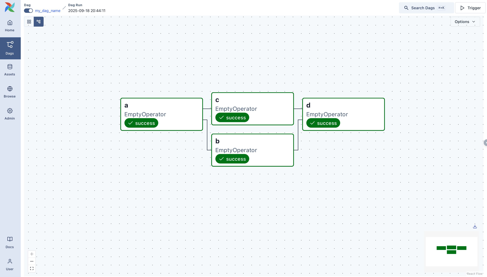
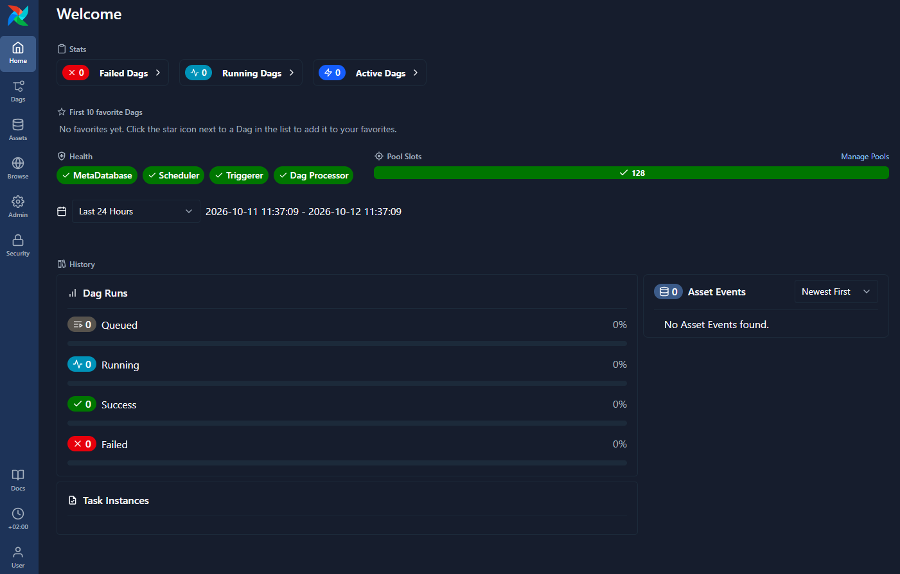
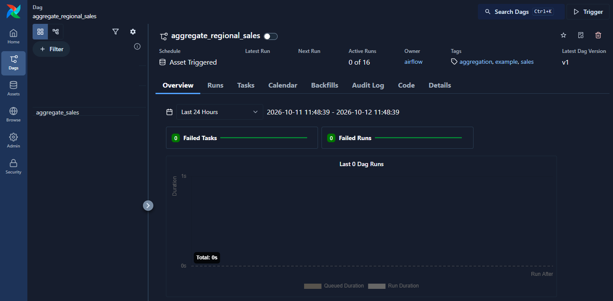

# Data Engineering: Pipeline Orchestration with Apache Airflow

## 1. Why Orchestrate? Getting to Know Airflow

### 1.1. Presentation

#### Instructor Presentation
* **Instructor:** Oscar Meyer (Solutions Architect at Datasight).
* **Experience:** Over 10 years of career in data (previous experience as a DBA, data engineering, and solutions architecture). Specialist focused on AWS (*AWS Data Analytics Specialty* certification).
* **Professional Context:** Working as a consultant helping clients transform businesses with data and AI, dealing with data architectures, agent-based systems, and modern Big Data ecosystems.

#### Course Objectives
* Convey practical and conceptual knowledge on using Apache Airflow in daily workflows.
* Follow a structured line of reasoning: from **foundations** to **execution in a practical project**.

#### Course Structure and Focus
1. **Understanding the Problem:** Comprehend what problem Airflow solves, its usefulness, proper usage, and comparison with other tools on the market.
2. **Ecosystem Exploration:** Capture essential Airflow concepts before starting practical work.
3. **Practical Project and Execution:**
   * Setting up the Airflow environment.
   * Writing DAGs in Python using operators.
   * Tracking executions, configuration, testing, and managing credentials.
   * Optimizations after the first version of the DAG.

#### Teaching Approach and Use of AI
* **Conceptual Focus:** The priority is not just manual code writing, but a deep understanding of the concepts, functioning, and application of the tool.
* **Use of Generative AI:** Leveraging AI as a co-pilot to collaborate on code writing and support development, allowing for natural testing and validation.

### 1.2. The Problem of Loose Scripts and Cron

#### **The Role of an Orchestrator**
* **Definition:** An orchestrator manages tasks, determines execution flow, controls processes, and handles logs.
* **Main Objective:** Resolves problems in data pipelines by ensuring that the beginning, middle, and end occur in the correct order with appropriate logging.

#### **Problems of the Traditional Model (Loose Scripts and Cron)**
* **Implicit dependencies:** Main scripts that call multiple sub-scripts lack internal visibility; a failure in the main script cascades to others, and issues become difficult to track.
* **Lack of visibility and control:** Running everything at once through a single monolithic script makes tracking and error handling cumbersome.
* **Scheduling rigidity:** Changing specific execution times (such as moving a script to run at 3 AM instead of midday) requires manual refactoring and creating separate Cron setups.
* **Heavy manual labor:** Performing manual retries and managing scattered logs without a dedicated tool demands massive operational overhead.

#### **Advantages of Using Airflow**
* **Centralized visibility:** A visual interface to manage tasks individually, monitor states, and centralize logs.
* **Use of Native Operators:** Abstracts integrations with external tools and APIs (such as Databricks), removing the need to write custom authentication and connection scripts.
* **Ecosystem Features:** Creation of DAGs, separate schedules, explicit dependency declarations, automated error notifications, and native log centralization.

### 1.3. What is Airflow and When to Use It

#### **What is Apache Airflow**
* **Definition:** An open-source platform maintained by the Apache Software Foundation, designed to create, schedule, and monitor workflows.
* **Creation and Scheduling:** Involves using operators to ease work, writing dynamic DAGs (Directed Acyclic Graphs) in Python, and scheduling by time or events.
* **Monitoring and Observability:** Groups the entire data ecosystem into a centralized tool, allowing end-to-end flow tracking.

#### **Core Features**
* **Python Language:** Everything is built essentially in Python, bringing versatility to orchestration.
* **Web Interface:** Allows pausing DAGs, viewing states, analyzing execution charts per task, checking queues, and consulting centralized logs with user management.
* **Robust Ecosystem:** Relies on a strong community that continuously maintains and improves the tool.

#### **When to Use Airflow**
* **Application Scenarios:** Indicated for ETL processes, real-time (RT) flows, batch data, automations with inter-step dependencies, retries, alerts, and execution histories.
* **Service Decoupling:** Ideal for fragmented environments with various separate tools (ingestion, processing, visualization), unifying operational visibility.

#### **What Airflow Is NOT**
* **Processing Engine:** Airflow does not process data directly (the role of tools like Spark or Pandas); its function is to orchestrate, call executions, manage dependencies, administer logs, and schedule tasks.
* **Direct Ingestion:** Although it manages the flow, the actual processing of ingestion is done by scripts calling APIs, rather than by internal distributed processing capabilities of Airflow.

### 1.4. Core Airflow Concepts

#### **DAG (Directed Acyclic Graph)**
* **Definition:** A set of tasks with a defined direction, no cycles, and a visual representation, serving as a pipeline or workflow in Airflow.
* **Characteristics:** 
  * **Directed:** Possesses a continuous flow with a beginning, middle, and end, following a determined direction that can include logical branching.
  * **Acyclic:** Does not return to a previous state, avoiding infinite loops.
  * **Graph:** Provides a visual tree-like structure to understand dependencies and connected elements.

#### **Operators, Tasks, and Task Instances**
* **Operator:** A template or reference model that abstracts manual steps and API communications (e.g., generic, Python, Databricks, or AWS operators).
* **Task:** The implementation resulting from instantiating an operator and assigning it a specific function within a script.
* **Task Instance:** The specific execution of a task on a given date or time, providing telemetry such as state, logs, and execution duration.

#### **Scheduler and Executor**
* **Scheduler:** The service responsible for reading DAGs and determining what and when tasks should run based on defined schedules.
* **Executor:** The mechanism that handles direct execution, managing whether tasks run locally, queue up due to parallel limits, or run inside containers.



### 1.5. Graph no Airflow

#### **A Profundidade do Conceito**
* **Definição:** O termo *Graph* vai além de uma mera representação visual, refletindo a conectividade entre as tarefas de uma DAG para formar um diagrama de dependências e ordem de execução[cite: 1].
* **Importância:** É crucial para compreender a orquestração de fluxos de dados, permitindo identificar bifurcações, junções e sequências lineares[cite: 1].

#### **Funcionalidade e Visualização**
* **Elementos visuais:** O *graph* permite visualizar rapidamente a estrutura hierárquica, os pontos de decisão e as relações de dependência entre as tarefas[cite: 1].
* **Utilidade prática:** Esse nível de visualização é fundamental para o *debug*, monitoramento, otimização e identificação de gargalos em *workflows* complexos[cite: 1].

#### **Abordagens de Visualização**
* **Visualização Estática:** Ideal para uma visão geral rápida; simples de ler, mas não reflete mudanças dinâmicas em tempo real[cite: 1].
* **Visualização Interativa:** Permite interagir com o diagrama, expandir detalhes e aceder a logs e tempos de execução ao clicar em cada nó[cite: 1].
* **Mapeamento por Camadas:** Organiza *workflows* complexos agrupando tarefas por funcionalidade para tornar o entendimento mais intuitivo[cite: 1].

## 2. Preparing the Environment (Lesson Setup)

### 2.1. Environment Setup & Docker Configuration
* **Development Environment (WSL2 & Ubuntu):** We use Windows 11 with the Windows Subsystem for Linux (WSL2) running Ubuntu to mirror a production-like Linux environment.
* **WSL Commands:** We use core terminal commands to interact with and verify our Linux distribution:
  * `wsl`: Starts the default Linux environment.
  * `wsl -l -v`: Lists installed Linux distributions and checks their WSL version (1 or 2).
* **Docker Installation & Validation:** We configured Docker Desktop with the WSL2 backend (enabling the *VirtualMachinePlatform* and restarting the system). To verify that the Docker ecosystem is active and working properly within WSL, we run:
  * `docker --version`: Checks the installed Docker version.
  * `docker compose version`: Validates the container orchestration tool.
* **Project Directory Structure (`project`):** Inside our project folder, we created the standard subdirectories required by Airflow:
  * **`dags`**: Stores our Python DAG scripts, which Airflow automatically detects and runs.
  * **`logs`**: Keeps execution history and task logs.
  * **`plugins`**: Reserved for custom extensions.
  * **`config`**: Holds additional configuration files.

  ### 2.2. Setting Up Airflow with Docker Compose

#### **Downloading and Inspecting the Configuration**
* **Docker Compose File:** Downloaded using the official Apache Airflow repository link via the command: curl -LfO '[https://airflow.apache.org/docs/apache-airflow/stable/docker-compose.yaml](https://airflow.apache.org/docs/apache-airflow/stable/docker-compose.yaml)'
* **Configuration Inspection:** Inspected via the command vi docker-compose.yaml to review settings such as the CeleryExecutor, default resource names, versioning, and default credentials.
* **Core Services Included:**
  * **PostgreSQL:** Database for metadata storage.
  * **Redis:** Manages execution queues.
  * **Airflow API Server:** Manages system core and mediates between containers and the database (replacing the traditional web server in Airflow 3).
  * **Airflow Scheduler:** Handles scheduling logic.
  * **Airflow DAG Processor:** Dedicated container for processing DAGs in Airflow 3.
  * **Airflow Worker:** Executes tasks.
  * **Airflow Triggerer:** Manages triggers and sensors.

#### **Environment Setup and Initialization**
* **Environment Variable:** Defined the AIRFLOW_UID variable using the current user ID to prevent permission issues via: echo -e "AIRFLOW_UID=$(id -u)" > .env
* **Initialization:** Executed the initialization command to download dependencies and set up the metadata database: docker compose up airflow-init
* **Starting Services:** Launched all background containers using detached mode once initialization completed with exit code 0: docker compose up -d

#### **Verification and Access**
* **Container Status:** Checked active containers using docker ps to ensure all services reached a healthy or started state.
* **Local vs. Server Access:** 
  * **Local Environment (WSL2):** Accessed via localhost:8080.
  * **Remote Server Environment:** Accessed via the server's public IP address or domain (http://<SERVER_IP>:8080), requiring appropriate firewall/security group port configurations (port 8080 open) and recommended reverse proxy setups (such as Nginx with SSL) for secure production deployments.
* **Default Credentials:** 
  * **Username:** airflow
  * **Password:** airflow

  ### 2.3. Essential Configurations & Volume Mapping

#### **The `AIRFLOW_UID` Variable**
* **Purpose:** Defined as `AIRFLOW_UID=1000` in the `.env` file to prevent permission issues between the host Linux environment and the containers.
* **Permission Management:** Without this variable, mounted container folders default to the container's root user, causing permission failures during file editing. Setting it ensures processes respect the operating system's execution user.

#### **Volume Mapping and Directory Synchronization**
* **Compose Configuration:** The `docker-compose.yaml` file maps local project folders (like `dags`, `logs`, `config`, and `plugins`) directly to corresponding paths inside the container (such as `/opt/airflow/dags`).
* **User Alignment:** The mapping configuration also incorporates the user variable to dictate process execution ownership within the container.
* **Behavior:** Any files created, modified, or removed locally in the `dags` folder are automatically synchronized and reflected inside the container in real time.

#### **Practical Verification**
* **Inspection Command:** Checked volume definitions inside the compose file using: cat docker-compose.yaml | grep -A 10 "volumes:"
* **Container Execution Check:** Used `docker compose exec airflow-apiserver ls /opt/airflow/dags/` to verify directory contents inside the container.
* **Synchronization Test:** Creating a temporary file (`touch dags/teste.py`) or removing it on the host machine instantly updates the state visible inside the container.

### 2.4. UI Tour & Architecture Overview

#### **Access and Version Context**
* **Accessing the UI:** Opened via the browser at `localhost:8080` using default administrator credentials.
* **Airflow 3 vs. Airflow 2:** Airflow 3 features a redesigned architecture and UI. Key changes include the transition from `webserver` to `apiserver`, direct database interactions replaced by API server mediation, and a dedicated `DAG Processor` container.



#### **Home and Dashboard Navigation**
* **Overview/Home:** Provides environment health statistics (Scheduler, Triggerer, DAG Processor, and PostgreSQL metadata database status) alongside failed, running, and active DAG metrics.
* **DAGs List:** The primary workspace for managing, triggering runs via play buttons, monitoring logs, and handling installed example DAGs.

#### **Views and DAG Details**
* **Visualization Options:** Includes Grid view, Graph view, and Diagram view to inspect task dependencies.
* **Execution & Metadata Tabs:** Offers execution history, task details, calendar views, backfill support, audit logs, and Python source code inspection under DAG Code.
* **Other Details:** Displays metadata such as `dag_id`, execution user, file path, parse time, and last interpretation timestamp.



#### **Advanced Features and Settings**
* **Assets & Navigation:** Introduces Assets for data passing workflows (replacing older Datasets), alongside system audit logs, jobs, XComs, and variables.
* **Security & Preferences:** User management and role configurations (handled via CLI in Airflow 3), timezone configurations, language/theme toggling, and API token generation.

### 2.5. Supplementary: User Management and Security

#### **Security Fundamentals in Airflow**
* **Scope:** Airflow security extends beyond task execution to encompass environment, data structure, and UI access control.
* **Objective:** Ensures identities can only view or alter authorized resources, protecting sensitive data and critical system operations.

#### **CLI-Based Control in Airflow 3**
* **Shift from Airflow 2:** Unlike Airflow 2 where some operations could be handled via the graphical interface, user registration in Airflow 3 is performed via the command-line interface (CLI).
* **Purpose:** Centralizes sensitive operations and minimizes the risk of accidental configurations through exposed interfaces.
* **Capabilities:** Administrators can precisely define roles and permissions, using specific commands to create, edit, and remove users while associating custom permission sets.

#### **Pros and Considerations**
* **Security Benefits:** Offers greater security by reducing the attack surface exposed on web interfaces, while automation via scripts maintains consistent access control standards in production.
* **Learning Curve:** Requires teams to be comfortable with command-line usage and security practices, introducing an initial learning curve that is offset by enhanced system robustness and auditability.

## 3: Your First DAG

### 3.1. Anatomy of a DAG: Vendemais Project & Incremental Implementation

#### **Project Context & Architecture**
* **Business Scenario:** Based on a fictional company called *Vendemais*, featuring two main pipelines (sales reporting and dollar-to-real exchange rate history).
* **Airflow's Role:** Acts strictly as an orchestrator rather than a dedicated ETL engine, managing Python scripts, ingestion processes, and transformations.
* **Separation of Concerns:** Business logic and data scripts are isolated within a `helpers` folder, separating execution logic from the core orchestration workflows inside DAG files.
* **Environment & Path Adjustments:** Additional directories like `helpers`, `data`, and `docs` require integration into the Airflow container via `PYTHONPATH` and updated volume mappings in the `docker-compose.yaml` file to ensure seamless imports.

#### **Incremental DAG Development (Sales Pipeline)**
* **Design Strategy:** Built iteratively starting with a basic structure using stubs before integrating business helpers.
* **Core Parameters & Metadata:**
  * `dag_id`: `"pipeline_vendas"`[cite: 1]
  * `schedule`: Set to `None` for manual execution in this initial phase[cite: 1].
  * `catchup`: Configured as `False` to prevent retrospective executions[cite: 1].
  * `default_args`: Includes a `start_date` (`datetime(2025, 1, 1)`), `owner`, `depends_on_past`, and resilience settings like `retries=3` with a 5-minute `retry_delay`.
* **Task Structure (TaskFlow API):** Utilizes `@dag` and `@task` decorators with implicit XCom data passing between sequential steps[cite: 1]:
  1. `extrair_dados`: Pulls raw sales CSV files using helper functions.
  2. `transformar_dados`: Processes and writes temporary summary files.
  3. `carregar_dados`: Moves transformed data to the final output destination.

#### **Verification**
* **Deployment Validation:** Restarted Docker services (`docker compose down` followed by `docker compose up -d`) to apply volume updates.
* **UI Inspection:** Confirmed successful registration of the `pipeline_vendas` DAG in the Airflow 3 interface, verifying proper task chaining under the Graph and Grid views.

### 3.2. Anatomy of a DAG: Core Components & Structure

#### **1. What is a DAG?**
* **Definition:** DAG stands for *Directed Acyclic Graph*. It is the core blueprint in Apache Airflow representing a collection of all the tasks you want to run, organized in a way that reflects their relationships and dependencies.
* **Directed:** Tasks have a defined direction or flow (e.g., Task A must finish before Task B starts).
* **Acyclic:** There are no loops or infinite cycles (Task B cannot loop back to trigger Task A directly in a way that creates an endless loop).

> **💡 Best Practice Tip: Orchestration vs. Business Logic**
> Airflow is an **orchestrator**, not a processing or transformation engine. A DAG should **not** contain heavy business logic or raw data processing code directly in its file. Instead, the DAG acts as a lightweight coordinator that imports and invokes Python functions and scripts stored in an external `helpers` folder (e.g., extracting or transforming data via modular scripts), keeping the pipeline clean and maintainable.

#### **2. Core Components of a DAG File**
* **Imports:** Necessary libraries to define the workflow. In modern Airflow (especially with Airflow 3), we heavily leverage the **TaskFlow API** (`@dag`, `@task`).
* **Default Arguments (`default_args`):** Dictionary defining standard metadata for the tasks, such as:
  * `owner`: The creator or team responsible for the pipeline.
  * `start_date`: The point in time from which the DAG starts scheduling and running.
  * `retries` & `retry_delay`: Resilience configurations defining how many times a failed task should retry and the waiting period between attempts.
* **DAG Definition Decorator (`@dag`):** The primary wrapper function that turns a Python function into an Airflow DAG. Key parameters include:
  * `dag_id`: The unique name of the pipeline visible in the UI.
  * `schedule`: Defines the frequency or cron expression for execution (`None` for manual runs).
  * `catchup`: Boolean flag (`False` recommended) to prevent Airflow from running all historical backfilled instances between the `start_date` and the current date.
  * `tags`: Labels used to filter and organize DAGs in the UI.

#### **3. Tasks and the TaskFlow API**
* **Tasks (`@task`):** Individual units of work (nodes in the graph) wrapped as Python functions.
* **Data Passing (Implicit XComs):** The TaskFlow API automatically handles passing return values from one task to the next under the hood using Airflow XComs, avoiding manual `push`/`pull` boilerplate code.
* **Dependency Chaining:** Task execution order is established naturally by calling the tasks sequentially inside the main DAG function (e.g., passing the output of `extrair_dados()` directly into `transformar_dados()`).

```python
from datetime import datetime, timedelta
from airflow.decorators import dag, task

# Define standard default arguments for the DAG tasks
DEFAULT_ARGS = {
    "owner": "airflow",
    "depends_on_past": False,
    "start_date": datetime(2025, 1, 1),
    "retries": 3,
    "retry_delay": timedelta(minutes=5),
}

@dag(
    dag_id="template_pipeline",
    default_args=DEFAULT_ARGS,
    schedule=None,  # Use None for manual runs, or cron expressions like "0 5 * * *" for scheduled runs
    catchup=False,
    tags=["template", "data-engineering"],
)
def template_pipeline():
    """
    Pipeline Documentation:
    This is a structural template demonstrating best practices for 
    Airflow 3 DAG development using the TaskFlow API and explicit helpers/stubs.
    """

    @task
    def extract_data() -> dict:
        """
        Extraction Task:
        Responsible for pulling raw data from files, APIs, or databases.
        Returns a dictionary or file path passed implicitly via XComs.
        """
        print("Starting data extraction...")
        # Example output metadata
        source_info = {"file_path": "/opt/airflow/data/input/source.csv"}
        return source_info

    @task
    def transform_data(extract_output: dict) -> str:
        """
        Transformation Task:
        Receives output from the extraction step, processes business logic,
        and saves results to a temporary or staging path.
        """
        input_path = extract_output.get("file_path")
        print(f"Transforming data from: {input_path}")
        
        output_path = "/opt/airflow/data/output/processed_data.csv"
        return output_path

    @task
    def load_data(transform_output: str):
        """
        Load Task:
        Takes the processed file path and loads it into the final data warehouse,
        destination folder, or target system.
        """
        print(f"Loading data from {transform_output} into final destination...")

    # --- Task Dependencies & Execution Flow ---
    # Chaining tasks sequentially using functional returns
    raw_data = extract_data()
    processed_data = transform_data(raw_data)
    load_data(processed_data)

# Instantiate the DAG object so Airflow can register it
template_pipeline()
```

### 3.3. Task Dependencies, Parallelism & Graph Visualization

#### **Task Chaining with Bitshift Operators**
* **Sequential Flow (`>>`):** Represents linear execution where downstream tasks wait for upstream task completion (e.g., `t_extrair >> t_transformar >> t_carregar`).
* **Upstream Operator (`<<`):** Works identically to `>>` but in reverse direction (rarely used in production environments to maintain left-to-right readability).

#### **Parallel Execution & Fan-In/Fan-Out Patterns**
* **Branching/Fan-Out (`[ ]`):** Grouping tasks inside brackets creates parallel execution paths following an initial step (e.g., `t_extrair >> [t_transformar, t_carregar]`).
* **Convergence/Fan-In:** A downstream task only runs after **all** parallel upstream tasks finish successfully (e.g., `t_extrair >> [t_transformar, t_carregar] >> t_enviar_email`).
* **Unconnected Tasks:** Declaring task instances without dependency operators causes them to trigger simultaneously without constraints.

#### **Dynamic Date Handling & Execution Context**
* **Logical Date (`ds`):** Using Airflow's Jinja context variable `ds` dynamically injects the logical execution date into file paths (e.g., `resumo_categoria_{ds}.csv`) instead of hardcoding dates.
* **Execution Validation:** Verified through the Graph View UI, ensuring tasks process input files from `/opt/airflow/data/input` and output final results to `/opt/airflow/data/output` according to the execution context.

### 3.4. Reading Logs and Debugging Errors

#### **Log Analysis and Filtering**
* **Grid View Insights:** Allows monitoring of execution states, historical runs, and performance metrics across pipeline tasks.
* **Filtering Capabilities:** Logs can be filtered by severity level (such as warnings or critical errors) and source origin (like Python or specific task components) to streamline troubleshooting.

#### **Task States and Manual Overrides**
* **State Management:** Airflow allows manual intervention to change a task state (e.g., flipping a false positive/negative between success and failure), with all alterations recorded in the audit logs.
* **Retries & Resilience:** Configured retry mechanisms automatically attempt recovery based on defined intervals (e.g., 3 attempts spaced by 5 minutes) before marking a task as a definitive failure (displayed in orange during retries and red upon failure).

#### **Error Correction and Re-execution**
* **Debugging Workflow:** When code errors occur (such as a missing DataFrame column key), logs pinpoint the exact exception stack trace.
* **Clearing and Rerunning:** Once fixes are applied to helper files, individual tasks can be cleared and re-executed independently without restarting the entire pipeline, or the full DAG can be rerun from the root level.

### 3.5. Supplementary: Volume Mapping and PythonPath in Docker Compose

#### **Understanding Volumes in Docker Compose**
* **Purpose:** Volumes allow host operating system directories to be mounted directly inside containers while maintaining the expected file structure[cite: 1].
* **Significance in Airflow:** Proper configuration avoids import issues and code synchronization failures across directories storing DAGs, helper scripts, and data[cite: 1].

#### **The Importance of PythonPath**
* **Definition:** PythonPath is an environment variable that informs the Python interpreter where to search for modules and packages to import[cite: 1].
* **Integration:** Because custom business logic and helper scripts reside in folders like `helpers` or `data` outside default paths, updating the PythonPath prevents "module not found" errors and promotes clean integration[cite: 1].

#### **Best Practices for Configuration**
* **Environment Configuration:** Review configuration files like `.env` to guarantee that the PythonPath includes all directories holding custom modules[cite: 1].
* **Compose Mapping:** Map all required folders (such as `helpers` and `data`) inside `docker-compose.yml` to keep them accessible within the container[cite: 1].
* **Restarting Services:** Always restart containers after altering configurations to ensure modifications are fully applied during execution[cite: 1].